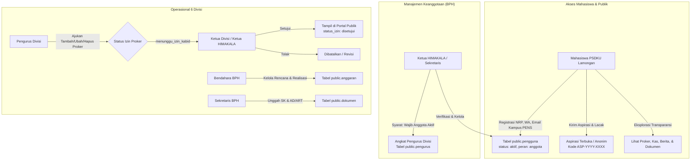

<div align="center">

  
  

  # HIMAKALA PSDKU Lamongan
  ### Portal Transparansi & Sistem Informasi Himpunan Mahasiswa PENS

  [](https://react.dev/)
  [](https://www.typescriptlang.org/)
  [](https://vitejs.dev/)
  [](https://tailwindcss.com/)
  [](https://supabase.com/)
  [](https://vitest.dev/)
  [](./DESIGN.md)

  <p align="center">
    Platform digital resmi <strong>HIMAKALA (Himpunan Mahasiswa PSDKU Lamongan)</strong> Politeknik Elektronika Negeri Surabaya.<br />
    Wadah transparansi program kerja, laporan keuangan kas, penerbitan dokumen resmi, dan penyaluran aspirasi mahasiswa Program Studi <strong>D3 Teknik Informatika</strong> dan <strong>D3 Multimedia Broadcasting</strong>.
  </p>

  <p align="center">
    <a href="#-panduan-cepat-quick-start"><strong>Mulai Instalasi »</strong></a> •
    <a href="#-matriks-peran--hak-akses"><strong>Matriks Hak Akses »</strong></a> •
    <a href="#-alur-kerja--arsitektur"><strong>Arsitektur Sistem »</strong></a> •
    <a href="./PANDUAN_ADMIN.md"><strong>Panduan Pengurus »</strong></a> •
    <a href="./DESIGN.md"><strong>Sistem Desain »</strong></a>
  </p>

</div>

---

## Daftar Isi

1. [Sorotan Fitur Utama](#-sorotan-fitur-utama)
2. [Alur Kerja & Arsitektur Sistem](#-alur-kerja--arsitektur-sistem)
3. [Panduan Cepat (Quick Start)](#-panduan-cepat-quick-start)
4. [Matriks Peran & Hak Akses (RBAC)](#-matriks-peran--hak-akses-rbac)
5. [Akun Awal untuk Pengujian Kolaborator](#-akun-awal-untuk-pengujian-kolaborator)
6. [Struktur Direktori Proyek](#-struktur-direktori-proyek)
7. [Sistem Desain & Aksesibilitas](#-sistem-desain--aksesibilitas)
8. [Panduan Kontribusi & Verifikasi Kualitas](#-panduan-kontribusi--verifikasi-kualitas)

---

## 🌟 Sorotan Fitur Utama

<table>
  <tr>
    <td width="50%" valign="top">
      <h3>🏛️ 6 Divisi Resmi HIMAKALA</h3>
      <p>Struktur organisasi terbagi atas <strong>BPH</strong>, <strong>Luar Negeri</strong>, <strong>Dalam Negeri</strong>, <strong>Media & Informasi</strong>, <strong>PSDM</strong>, dan <strong>RSTEK</strong> dengan modul kerja spesifik untuk masing-masing divisi.</p>
    </td>
    <td width="50%" valign="top">
      <h3>🎓 Registrasi Mandiri Mahasiswa PENS</h3>
      <p>Anggota biasa dapat mendaftar langsung dengan <strong>NRP</strong> (8-14 digit), <strong>No. WhatsApp</strong>, <strong>Email Kampus PENS</strong> (<code>@*.student.pens.ac.id</code>), dan verifikasi password ganda (2 kali).</p>
    </td>
  </tr>
  <tr>
    <td width="50%" valign="top">
      <h3>⚡ Tata Kelola & Syarat Pengurus</h3>
      <p>Hanya <strong>Ketua HIMAKALA</strong> dan <strong>Sekretaris BPH</strong> yang berwenang menambah anggota serta mengangkat pengurus. Syarat wajib menjadi pengurus adalah harus berstatus <strong>Anggota Aktif HIMAKALA</strong>.</p>
    </td>
    <td width="50%" valign="top">
      <h3>⚖️ Alur Izin Program Kerja (Proker)</h3>
      <p>Pengurus divisi mengajukan pembaruan proker dengan status <code>menunggu_izin_kabid</code>. Perubahan baru tampil ke publik setelah diverifikasi dan disetujui oleh <strong>Ketua Divisi</strong> atau <strong>Ketua HIMAKALA</strong>.</p>
    </td>
  </tr>
  <tr>
    <td width="50%" valign="top">
      <h3>📊 Transparansi Kas & Anggaran Realtime</h3>
      <p>Pencatatan pos anggaran rencana vs realisasi per program kerja dengan format Rupiah presisi, status persetujuan bendahara, dan visualisasi capaian keuangan organisasi.</p>
    </td>
    <td width="50%" valign="top">
      <h3>📬 Aspirasi Publik & Pelacakan Unik</h3>
      <p>Mahasiswa dapat mengirim aspirasi umum maupun anonim aman dengan penerbitan kode pelacakan otomatis berformat <code>ASP-YYYY-XXXX</code> untuk memantau status tindak lanjut pengurus.</p>
    </td>
  </tr>
</table>

---

## 🔄 Alur Kerja & Arsitektur Sistem

Sistem memadukan antarmuka statis dengan manajemen sesi dinamis yang terhubung ke basis data PostgreSQL Supabase:



---

## 🚀 Panduan Cepat (Quick Start)

Ikuti 4 langkah terstruktur berikut untuk menyiapkan lingkungan pengembangan lokal Anda:

### 1. Prasyarat Sistem
- **Node.js** versi `>= 18.x` dan **npm** versi `>= 9.x`
- Proyek aktif di **Supabase** (PostgreSQL terkelola)
- Git untuk kontrol versi

### 2. Setup Database Supabase (`backend/`)
Untuk proyek Supabase baru, Anda cukup menjalankan satu berkas SQL gabungan:
1. Buka dashboard proyek Supabase Anda.
2. Masuk ke menu **SQL Editor** pada navigasi kiri.
3. Buka berkas [backend/database/FULL_SETUP_HIMAKALA.sql](./backend/database/FULL_SETUP_HIMAKALA.sql), salin seluruh isinya, lalu tempel ke SQL Editor Supabase.
4. Klik **Run** untuk mengeksekusi skrip.
5. Skrip ini secara otomatis membuat:
   - 8 tipe ENUM database (`peran_pengguna`, `status_proker`, `status_izin_proker`, dll.).
   - 12 tabel utama beserta relasi antar-tabel dan *foreign key*.
   - 6 divisi resmi HIMAKALA dan periode kepengurusan aktif.
   - Aturan keamanan Row Level Security (RLS).
   - Akun awal pengurus dan anggota di tabel `public.pengguna`.

> [!TIP]
> Jika database Anda sudah berjalan dan hanya membutuhkan pembaruan skema registrasi (NRP, No. WA, Email Kampus PENS, serta syarat pengurus anggota aktif), jalankan berkas migrasi [backend/database/03_update_registrasi_anggota_dan_pengurus.sql](./backend/database/03_update_registrasi_anggota_dan_pengurus.sql).

### 3. Konfigurasi Environment Variable (`frontend/.env`)
Salin berkas template lingkungan ke direktori `frontend/`:
```bash
cd frontend
cp .env.example .env
```
Buka `.env` dan isi dengan URL proyek serta kunci anon publik Anda dari Dashboard Supabase (**Project Settings -> API**):
```env
VITE_SUPABASE_URL=https://<project-ref>.supabase.co
VITE_SUPABASE_ANON_KEY=<anon-public-key>
```

### 4. Instalasi Dependensi & Menjalankan Aplikasi
```bash
# 1. Masuk ke folder frontend
cd frontend

# 2. Pasang paket dependensi
npm install

# 3. Jalankan server pengembangan lokal
npm run dev
# Akses aplikasi di browser pada: http://127.0.0.1:5173

# 4. Jalankan pengujian unit otomatis
npm run test

# 5. Build aplikasi untuk rilisan produksi
npm run build
```

---

## 🛡️ Matriks Peran & Hak Akses (RBAC)

Autentikasi menggunakan kredensial **Email / NRP** dan **Password** tanpa dropdown peran manual pada form login. Sistem membaca atribut peran pengguna dari enum `public.peran_pengguna`:

| Peran (`peran_pengguna`) | Penempatan Divisi | Hak Operasional Program Kerja | Hak Keanggotaan & Pengurus | Akses Menu Navigasi |
| :--- | :--- | :--- | :--- | :--- |
| **`anggota`** | - | **Hanya Baca**: Melihat katalog kegiatan & transparansi | Tidak Ada | Beranda, Program Kerja, Transparansi Kas & Dokumen, 6 Divisi, Berita, Aspirasi |
| **`pengurus_divisi`** | Sesuai Divisi | **CRUD Atas Izin**: Perubahan proker masuk antrean `menunggu_izin_kabid` | Tidak Ada | Proker Divisi (Izin), Modul Divisi (Medinfo / PSDM / Dalam Negeri) |
| **`ketua_divisi`** | Luar Negeri, Dalam Negeri, Medinfo, PSDM, RSTEK | **Bebas CRUD Mandiri** pada divisinya + **Memberi Izin / Menolak** pengajuan pengurus divisinya | Tidak Ada | CRUD Proker Divisi, Antrean Izin Divisi, Modul Divisi |
| **`sekretaris`** | BPH | **Bebas CRUD Mandiri** tanpa izin siapapun | **Dapat Menambah Anggota & Mengangkat Pengurus** | CRUD Proker, Dokumen & SK, Anggota Aktif, Angkat Pengurus |
| **`bendahara`** | BPH | **Bebas CRUD Mandiri** tanpa izin siapapun | Tidak Ada | CRUD Proker, Manajemen Kas & Anggaran |
| **`ketua_himakala`** | BPH (Ketua BPH) | **Akses Penuh (Full CRUD)** pada seluruh 6 divisi | **Dapat Menambah Anggota & Mengangkat Pengurus** | Semua modul kepengurusan, Izin 6 Divisi, Anggota Aktif, Angkat Pengurus |

---

## 🔑 Akun Awal untuk Pengujian Kolaborator

Setelah menjalankan skrip SQL [FULL_SETUP_HIMAKALA.sql](./backend/database/FULL_SETUP_HIMAKALA.sql), seluruh akun contoh berikut siap digunakan dengan kata sandi bawaan **`himakala123`**:

| Jabatan / Peran | Identitas Login (Email / NRP) | Peran Database | Hak Istimewa |
| :--- | :--- | :--- | :--- |
| **Ketua HIMAKALA** | `ketua@himakala.ac.id` / `3124500001` | `ketua_himakala` | Full CRUD 6 Divisi, Manajemen Anggota & Pengurus |
| **Sekretaris BPH** | `sekretaris@himakala.ac.id` / `3124500002` | `sekretaris` | Kelola Dokumen & SK, Manajemen Anggota & Pengurus |
| **Bendahara BPH** | `bendahara@himakala.ac.id` / `3124500003` | `bendahara` | Kelola Kas & Anggaran, Validasi Laporan Keuangan |
| **Ketua Divisi Luar Negeri** | `kabid.ln@himakala.ac.id` / `3124500004` | `ketua_divisi` | CRUD Proker Luar Negeri & Persetujuan Izin Divisi |
| **Pengurus Divisi Luar Negeri** | `pengurus.ln@himakala.ac.id` / `3124500005` | `pengurus_divisi` | Pengajuan Proker Luar Negeri (menunggu izin kabid) |
| **Ketua Divisi RSTEK** | `kabid.rstek@himakala.ac.id` / `3124500012` | `ketua_divisi` | CRUD Proker RSTEK & Persetujuan Izin Divisi |
| **Pengurus Divisi RSTEK** | `pengurus.rstek@himakala.ac.id` / `3124500013` | `pengurus_divisi` | Pengajuan Proker RSTEK (menunggu izin kabid) |
| **Anggota Aktif Biasa** | `anggota@it.student.pens.ac.id` / `3124500099` | `anggota` | Akses Baca Publik, Kirim Aspirasi, Bebas Izin CRUD |

> [!NOTE]
> Anda juga dapat mencoba alur **Registrasi Mandiri** langsung di antarmuka web menggunakan email mahasiswa PENS Anda sendiri (contoh: `mozakiibrahim@it.student.pens.ac.id`) tanpa khawatir bentrok data akun bawaan di atas.

---

## 📁 Struktur Direktori Proyek

```text
HIMAKALA/
├── README.md                                   # Panduan utama arsitektur proyek & instalasi
├── PANDUAN_ADMIN.md                            # Panduan operasional pengurus per peran & divisi
├── DESIGN.md                                   # Dokumentasi sistem desain, palet warna, & audit WCAG
│
├── frontend/                                   # Klien Web (React 18, TypeScript, Vite, Tailwind CSS)
│   ├── README.md                               # Panduan teknis arsitektur frontend
│   ├── .env.example                            # Templat variabel lingkungan Supabase
│   ├── index.html                              # Entry point HTML aplikasi
│   ├── src/
│   │   ├── assets/                             # Logo resmi HIMAKALA & PENS
│   │   ├── components/
│   │   │   ├── layout/AppShell.tsx             # Frame statis h-screen, sidebar dinamis, modal auth
│   │   │   └── shared/DataStateView.tsx        # Indikator loading, empty state, & badge status
│   │   ├── data/initial-data.ts                # Definisi 6 divisi resmi (tanpa data dummy)
│   │   ├── lib/utils.ts                        # Format Rupiah, validasi NRP/WA/Email, RBAC helpers
│   │   ├── pages/
│   │   │   ├── public/                         # Halaman Beranda, Proker, Transparansi, 6 Divisi, Berita, Aspirasi
│   │   │   └── admin/AdminPanelPage.tsx        # Workspace CRUD kepengurusan & antrean persetujuan izin
│   │   ├── services/
│   │   │   ├── supabase-client.ts              # Inisialisasi klien @supabase/supabase-js
│   │   │   └── himakala-store.tsx              # Manajemen state global & sinkronisasi database
│   │   └── types/entities.ts                   # Definisi tipe TypeScript untuk entitas sistem
│   └── tests/
│       └── himakala.test.ts                    # Rangkaian pengujian unit otomatis (Vitest)
│
└── backend/                                    # Basis Data, Keamanan, & Serverless Backend
    ├── README.md                               # Panduan manajemen basis data Supabase
    ├── .env.example                            # Templat variabel lingkungan backend
    ├── database/
    │   ├── FULL_SETUP_HIMAKALA.sql             # Skrip SQL lengkap sekali jalan untuk Supabase
    │   ├── 02_update_auth_pengguna.sql         # Patch tabel pengguna & enum peran
    │   ├── 03_update_registrasi_anggota...sql  # Patch registrasi mandiri & validasi pengurus aktif
    │   ├── migrations/                         # Berkas migrasi DDL terstruktur (enums, tables, triggers)
    │   ├── policies/0001_rls_policies.sql      # Kebijakan Row Level Security (RLS) PostgreSQL
    │   └── seed/01_seed_initial_data.sql       # Data awal 6 divisi & periode resmi
    ├── storage/0001_storage_buckets.sql        # Skrip inisialisasi storage bucket publik/dokumen
    ├── functions/                              # Supabase Edge Functions (Deno / TypeScript)
    └── scripts/migrate-legacy-localstorage.ts  # Utilitas migrasi data lama
```

---

## 🎨 Sistem Desain & Aksesibilitas

Antarmuka HIMAKALA dibangun mengikuti pedoman visual yang diadaptasi langsung dari anatomi logo resmi himpunan:

| Token Warna | Nilai Hex | Peran Visual | Rasio Kontras WCAG |
| :--- | :--- | :--- | :--- |
| **Deep Navy** | `#0B1938` | Bingkai navigasi, teks judul, batas tinta kartu | **16.29:1** di atas putih (Lulus AAA) |
| **Ocean Cyan-Blue** | `#026E9C` | Tombol aksi utama (CTA), tautan fokus, sorotan aktif | **5.66:1** di atas putih (Lulus AA) |
| **Golden Fish Yellow** | `#FAD956` | Lencana status aktif, kartu divisi BPH | **12.50:1** dengan teks Deep Navy (Lulus AAA) |
| **Sky Cyan Gear** | `#C8ECFA` | Kartu divisi RSTEK, aksen aksidental | **13.91:1** dengan teks Deep Navy (Lulus AAA) |
| **Royal Blue Shark** | `#D8E4FC` | Kartu divisi Luar Negeri, panel informasi sekunder | **13.57:1** dengan teks Deep Navy (Lulus AAA) |
| **Cool Ice White** | `#F5F8FC` | Kanvas latar belakang utama aplikasi | **16.29:1** dengan teks Deep Navy (Lulus AAA) |

### Prinsip Tata Letak Statis (Crisp Shell)
- **Frame Luar Terkunci**: Elemen bingkai luar dan bilah navigasi vertikal diatur menggunakan kelas Tailwind `h-screen overflow-hidden` agar menu navigasi selalu tetap di tempat.
- **Inner Scroll Only**: Hanya wadah konten utama (`<main id="main-content" className="overflow-y-auto">`) yang dapat digulir oleh pengguna.
- **Zero Dummy Data**: Seluruh tabel operasional dimulai dari keadaan bersih (`[]`) untuk mencerminkan integritas data riil dari Supabase.

---

## 🤝 Panduan Kontribusi & Verifikasi Kualitas

Setiap kolaborator diharapkan menjaga konsistensi kode dan kepatuhan arsitektur sebelum mengirimkan Pull Request (PR):

1. **Aturan Gaya Penulisan & Komentar**:
   - Terapkan standar kode yang bersih dan hindari penambahan komentar berlebihan yang bersifat pengulangan sintaks.
   - Pertahankan konsistensi penamaan variabel berbahasa Indonesia yang selaras dengan skema database (`peran_pengguna`, `id_divisi`, `status_aktif`, `proker`).
2. **Kepatuhan Tipografi Antislop**:
   - Seluruh teks antarmuka dan dokumentasi tidak menggunakan karakter tanda pisah em-dash. Gunakan tanda hubung biasa, titik dua, atau tanda kurung.
3. **Eksekusi Verifikasi Mandiri**:
   Jalankan pemeriksaan lokal berikut di direktori `frontend/`:
   ```bash
   cd frontend
   npm run test
   npm run build
   ```
   Pastikan seluruh pengujian unit lulus (12/12) dan tidak ada kesalahan kompilasi tipe TypeScript (`tsc -b`).

---

<div align="center">
  <p>
    Dikelola dengan dedikasi oleh <strong>Himpunan Mahasiswa PSDKU Lamongan (HIMAKALA)</strong><br />
    Politeknik Elektronika Negeri Surabaya (PENS) • Kampus Lamongan
  </p>
</div>
